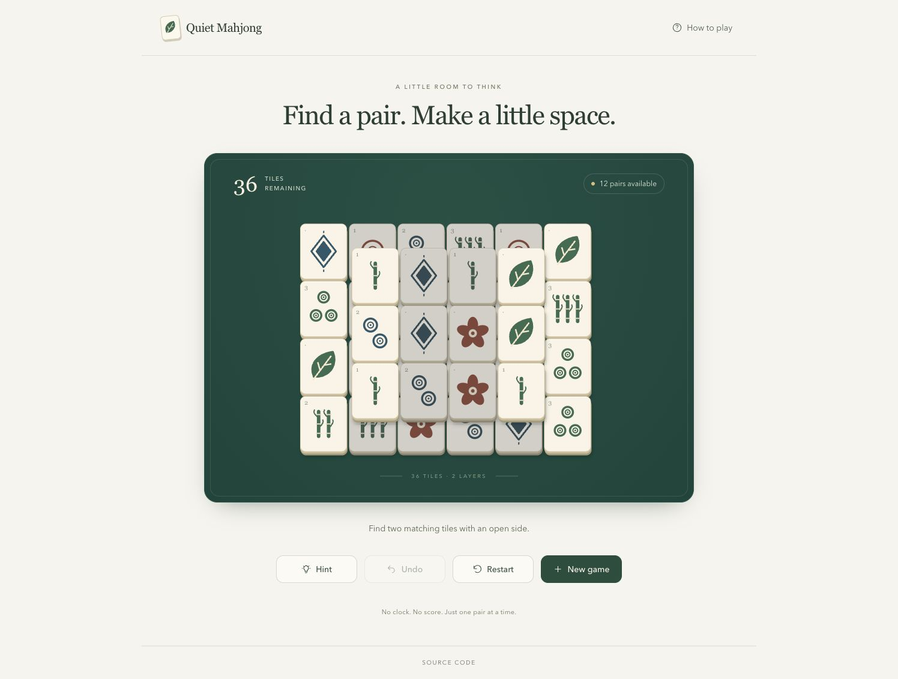

# Quiet Mahjong

A Mahjong Solitaire game with 36 tiles, two layers, and no clock.

[Play the game](https://augustoalegon.github.io/cardjo/) · [Watch the video](https://www.loom.com/share/707e807a20ee4f73a3b5e740ffefb772) · [View CI](https://github.com/AugustoAleGon/cardjo/actions)



## Setup

Use Node 22.16.0, pnpm 10.12.1, and Python 3.13 or later.
Python runs the prose check.

```sh
pnpm install --frozen-lockfile
pnpm dev
```

Open <http://localhost:5173/cardjo/>.

| Command | Purpose |
| --- | --- |
| `pnpm dev` | Start the development server. |
| `pnpm lint` | Check TypeScript and JavaScript with Oxlint. |
| `pnpm lint:prose` | Check authored Markdown and game text. |
| `pnpm test` | Run the Vitest suite once. |
| `pnpm build` | Check types and create the production build. |
| `pnpm preview` | Serve the production build locally. |
| `pnpm test:browser` | Check the production build in Chromium. |

The browser check requires a production build and Playwright Chromium.

```sh
pnpm exec playwright install --with-deps chromium
pnpm build
pnpm test:browser
```

## Rules

Match two distinct, available tiles with the same face.
A tile is available when no higher tile covers it and its left or right side is open.
A side blocker must touch that side on the same layer.
Its vertical span must overlap the tile.
Edge contact alone does not count as coverage.

The base layer contains six columns and four rows.
The upper layer contains four columns and three rows.
Upper rows sit halfway between base rows.
Each of the nine faces appears four times.

Select an available tile to highlight it.
Select the same tile again to clear the selection.
Select a different face to move the selection.
Select a matching face to remove both tiles.
Blocked tiles do not respond to selection.

## Controls

- **Hint** highlights the first legal pair in layout order. It does not guarantee a winning path.
- **Undo** restores the last pair. You can undo every match, including the final match.
- **Restart** restores the exact starting deal.
- **New game** creates a different solvable deal.

An unfinished game requires confirmation before a reset discards removed pairs.
Cancellation preserves the board, selection, history, and hint.
No confirmation appears after victory or after you undo every match.
Reloading the page starts a new game.

Use a mouse or touch to select tiles and controls.
Use Tab or Shift+Tab to move keyboard focus.
Use Enter or Space to activate a control.
After a keyboard match, focus moves to an available tile.
If no tile is available, focus moves to a recovery control.
Use Escape to close the instructions.

## Architecture

- `src/game/engine.ts` contains pure rules, transitions, and deal generation.
- `src/game/store.ts` creates isolated Zustand stores with an injectable random source.
- `src/game/useGame.ts` connects one page store to React selectors.
- `src/components/Board.tsx` renders stable positions and manages focus after keyboard matches.
- `src/components/Symbol.tsx` draws the original SVG faces.
- `src/messages.json` contains game text and accessible labels.

The generator first records a random legal removal sequence.
It clears the upper layer before the base layer.
Each layer has an even tile count, so this order avoids a final covered tile.
The generator then shuffles 18 face entries and assigns one entry to each pair.
Each face has two entries.
Replaying the recorded sequence clears the starting deal.
Other legal choices can cause a dead end.

The store keeps the starting deal, removed IDs, selection, hint, and pair history.
Each match updates removed IDs and history in one operation.
Tests check that removed IDs equal the IDs in history.
Selectors derive availability, legal pairs, remaining tiles, and game status.
Shallow selectors stabilize collections of tile references or IDs.
There is no persistence or state synchronization through effects.

Tailwind utilities define the interface styles.
A small stylesheet defines board geometry, tile depth, and reduced motion.
Tile shapes distinguish faces without dependence on color.
The board fits screens from 360 pixels wide.
Native buttons provide keyboard operation and visible focus.
A live status region announces selection, hints, victory, and dead ends.

## Tests

The suite contains 36 tests across the engine, store, and interface.
It replays generated solutions across 100 deterministic seeds.
It also checks varied legal choices across 100 generated deals.

The checks cover overlap, side blocking, face counts, invalid input, matching, atomic removal, hints, undo, resets, and store isolation.
Interface tests cover reset confirmation, cancellation, victory, and dead-end recovery.
Browser checks cover mouse input, keyboard focus, phone sizing, instructions, and complete games.
The CI browser check also tests touch input, reset dialogs, reduced motion, and reload behavior.

## CI and hosting

GitHub Actions runs lint, prose checks, tests, browser checks, and the production build on pushes and pull requests.
Deployment requires all checks to pass.
Only pushes to `main` deploy to GitHub Pages.
CI installs dependencies with the committed lockfile.

This repository uses the Pages address `https://augustoalegon.github.io/cardjo/`.
Vite therefore uses `/cardjo/` as its asset base.
This path belongs to GitHub Pages hosting, not to a game route.

## Writing skill

The project includes the [ASD-STE100 skill](https://github.com/danyuchn/asd-ste100-skill).
The source commit is `3944283c183eea13fe5bd902b572da3b4de8bf44`.
The copied files retain the upstream license, references, and linter.
`AGENTS.md` requires agents to read and apply the skill.

The prose check extracts strings from the game text JSON file.
It also checks authored Markdown.
It excludes copied skill files and generated files.
The upstream linter uses its default zero-error baseline.
Advisory findings require manual review.
Manual review also checks meaning, terminology, and instruction length.
The skill does not prove official dictionary compliance.

## Scope and time

This version excludes shuffle, saved progress, scoring, timers, sound, extra layouts, accounts, and multiplayer.
It uses one fixed layout and original tile art.

Implementation started at 21:37:50 UTC on October 15, 2026.
The limit is 60 consecutive minutes, including installation and deployment waits.
Implementation, checks, and deployment finished in less than 30 minutes.
Planning and video recording are outside this period.

See [release validation](docs/VALIDATION.md) for observations and screenshots.
See [AI notes](docs/AI-NOTES.md) for decisions and corrections.
